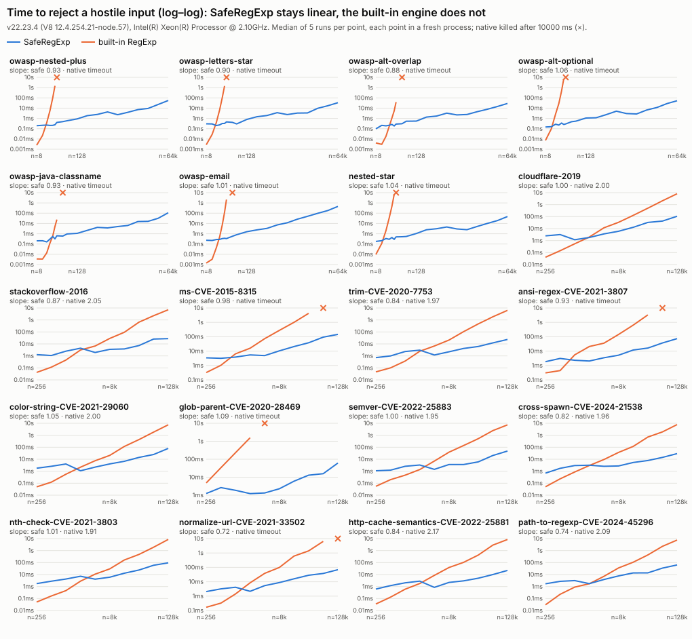
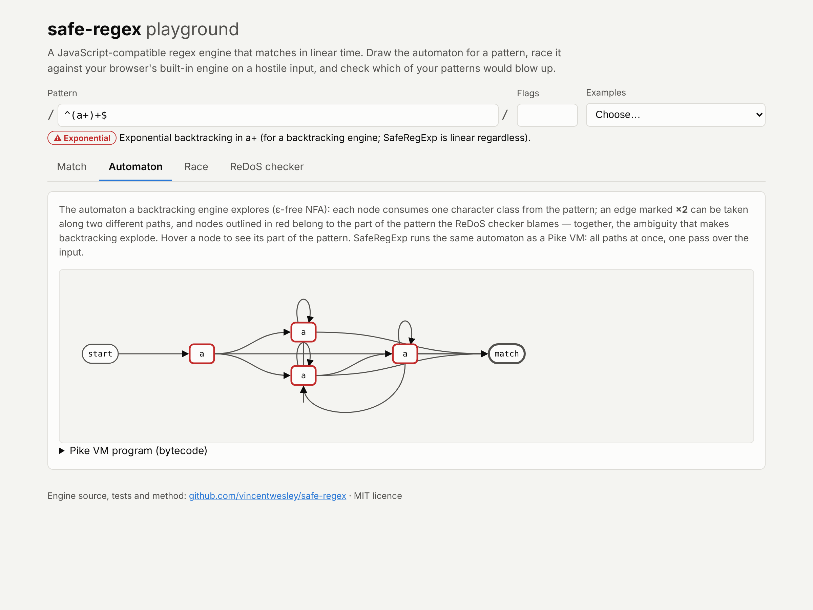
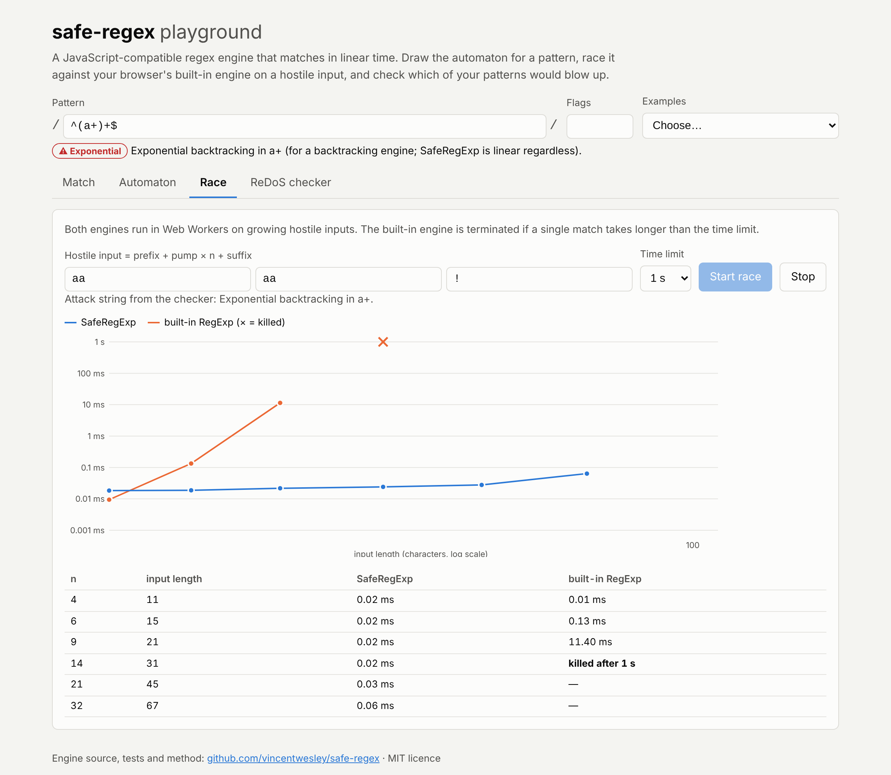
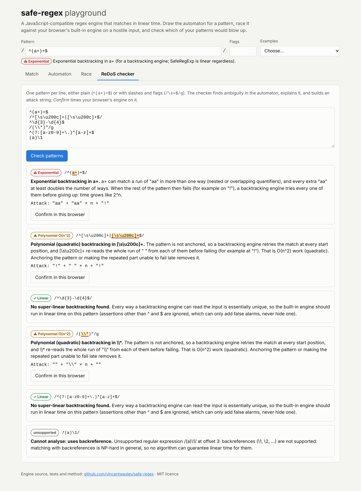

# safe-regex

[](https://www.npmjs.com/package/@vincentwesley/safe-regex)
[](https://github.com/vincentwesley/safe-regex/actions/workflows/ci.yml)


**A JavaScript regular-expression engine that can't be made to hang.** `SafeRegExp` has the same API and gives the same results as the built-in `RegExp`, but it compiles the pattern to an automaton and matches it in time proportional to the input. Catastrophic backtracking — the cause of ReDoS outages — cannot happen, whatever the pattern and whatever the input.

## New here? What is this?

A **regular expression** ("regex") is a short search pattern that programs use to check text, for example "does this look like an email address?". Most of the time it works fine. But some patterns can be tricked: a specially crafted text makes the program try an enormous number of ways to match, and it runs for minutes instead of milliseconds. That is called **ReDoS** (a "freezing" attack). In 2016 a single pattern like this took Stack Overflow offline for 34 minutes.

**safe-regex** is a replacement regex engine for JavaScript that can't freeze like that: it always finishes in time proportional to the length of the text. It also includes a checker that tells you which of your existing patterns are risky.

**Try it in your browser: https://vincentwesley.github.io/safe-regex/ - no install needed.**

```js
import { SafeRegExp } from '@vincentwesley/safe-regex';

const evil = 'a'.repeat(100_000) + '!';

/^(a+)+$/.test(evil);                  // built-in engine: never finishes in practice (2^100000 paths)
new SafeRegExp('^(a+)+$').test(evil);  // false, in about 0.1 s
```

* Written from scratch in TypeScript; **zero runtime dependencies**, no native code, no WebAssembly. Runs in Node ≥ 20 and every modern browser.
* **Same results as JavaScript.** Differential fuzzing compares it with V8 on random patterns, flags and inputs: [**7,606,021** comparisons, 0 failures](#correctness-differential-fuzzing) (where V8 itself departs from the ECMAScript spec, SafeRegExp follows the spec, and the fuzzer verifies that too).
* **Linear on all 20 ReDoS patterns** collected from CVEs, outage post-mortems and OWASP, where the built-in engine is quadratic, cubic or exponential: [benchmark](#benchmark-redos-patterns).
* Comes with a **ReDoS checker** (`analyze()`) that tells you which of your existing patterns would blow up in the built-in engine, why, and with what input — and a [**playground**](#playground) that draws the automaton and races both engines live.

---

## Contents

- [Install](#install)
- [Usage](#usage)
- [What is supported](#what-is-supported) · [What is not, and why](#not-supported)
- [How it works](#how-it-works)
- [Correctness: differential fuzzing](#correctness-differential-fuzzing)
- [Benchmark: ReDoS patterns](#benchmark-redos-patterns) · [Performance on ordinary input](#performance-on-ordinary-input)
- [ReDoS checker](#redos-checker)
- [Playground](#playground)
- [Comparison with other linear-time engines](#comparison-with-other-linear-time-engines)
- [Differences from the built-in RegExp](#differences-from-the-built-in-regexp)
- [Development](#development)

## Install

```bash
npm install @vincentwesley/safe-regex
```

The package name is `@vincentwesley/safe-regex` (the unscoped `safe-regex` on npm is an unrelated ReDoS *detector*). ES modules and CommonJS are both provided, with TypeScript types.

```js
import { SafeRegExp } from '@vincentwesley/safe-regex';      // ESM
const { SafeRegExp } = require('@vincentwesley/safe-regex'); // CommonJS
```

## Usage

`SafeRegExp` is a drop-in for `RegExp` wherever you control the construction:

```js
import { SafeRegExp } from '@vincentwesley/safe-regex';

// exec / test, captures, named groups, indices
const date = new SafeRegExp('(?<y>\\d{4})-(?<m>\\d\\d)-(?<d>\\d\\d)', 'd');
const m = date.exec('released 2026-11-15');
m.index;          // 9
m.groups.y;       // '2026'
m.indices.groups.m; // [14, 16]

// String methods accept it, exactly like a RegExp
'a-b_c'.split(new SafeRegExp('[-_]'));                       // ['a', 'b', 'c']
'x1y22'.replace(new SafeRegExp('(\\d+)', 'g'), '<$1>');      // 'x<1>y<22>'
[...'a1b22'.matchAll(new SafeRegExp('\\d+', 'g'))].map(m => m[0]); // ['1', '22']
'2026-11'.replace(new SafeRegExp('(?<y>\\d+)-(?<m>\\d+)'), '$<m>/$<y>'); // '11/2026'
'hello'.search(new SafeRegExp('l+'));                        // 2

// global / sticky iteration with lastIndex
const word = new SafeRegExp('\\w+', 'g');
word.exec('hi there'); word.lastIndex; // 2

// Build from an existing RegExp (only its source and flags are read)
const safe = new SafeRegExp(/^(\w+\s?)*$/i);
```

Untrusted patterns are fine too — the time bound holds for *any* pattern:

```js
import { SafeRegExp, checkSupport } from '@vincentwesley/safe-regex';

const userPattern = req.query.q;
const ok = checkSupport(userPattern, 'i');
if (!ok.ok) return res.status(400).send(ok.message);  // syntax error, or an unsupported feature with the reason
const hits = lines.filter((l) => new SafeRegExp(userPattern, 'i').test(l));
```

Very large counted repetitions are capped so a pattern can't compile to a huge program: `new SafeRegExp('(?:a{1000}){1000}')` throws `SafeRegexLimitError`. The cap is `maxProgramSize` (default 100 000 instructions): `new SafeRegExp(p, flags, { maxProgramSize: 1e6 })`.

### Errors

| Error | When | Extends |
|---|---|---|
| `SafeRegexSyntaxError` | the pattern or flags are invalid JavaScript (the built-in `RegExp` would throw too) | `SyntaxError` |
| `SafeRegexUnsupportedError` | valid JavaScript that SafeRegExp does not support; has `.feature` (a code from the table below) and the reason in `.message` | `SyntaxError` |
| `SafeRegexLimitError` | the compiled program would exceed `maxProgramSize` | `RangeError` |

## What is supported

Everything in day-to-day JavaScript regexes:

| | |
|---|---|
| Literals and escapes | `a`, `\n \r \t \v \f \0`, `\xHH`, `\uHHHH`, `\u{H…}` (with `u`), `\cX`, identity escapes; Annex B leniencies without `u` (`]`, `{`, `\c`, `\8`, `x{` as literals) |
| Character classes | `[abc]`, `[^a-z]`, `[\d\s]`, `.`, `\d \D \w \W \s \S`, `[\b]` |
| Anchors and boundaries | `^ $` (with and without `m`), `\b \B` |
| Groups | `(…)`, `(?:…)`, `(?<name>…)` |
| Alternation | `a|b` |
| Quantifiers | `* + ? {n} {n,} {n,m}` and their lazy forms `*? +? ?? {n,m}?` |
| Flags | `d` (indices), `g`, `i`, `m`, `s`, `u`, `y` |
| Unicode | `u`-mode code points and surrogate pairs; case-insensitive matching with both of the spec's canonicalisations (`toUpperCase` without `u`; Unicode 17.0 simple case folding with `u`, including `ſ`/`K` in `\w` and `\b`) |

<a id="not-supported"></a>
## What is not supported, and why

These are valid JavaScript but are rejected at construction with `SafeRegexUnsupportedError`. The `feature` code is on the error.

| `feature` | Syntax | Why |
|---|---|---|
| `backreference` | `\1` … `\99` | Matching with backreferences is NP-hard in general, so no algorithm — this one included — can guarantee linear time for them. |
| `named-backreference` | `\k<name>` | Same as above. |
| `lookahead` | `(?=…)`, `(?!…)` | Lookarounds *can* be matched in linear time (Barrière & Pit-Claudel, PLDI 2024), but it takes an extra pass over the input per assertion, which this single-pass engine does not implement yet. |
| `lookbehind` | `(?<=…)`, `(?<!…)` | As for lookahead, with a backward pass. |
| `unicode-property` | `\p{…}`, `\P{…}` (with `u`) | The engine doesn't ship Unicode property tables. |
| `unicode-sets-flag` | the `v` flag | Not implemented (class set operations, string properties). |
| `legacy-octal` | `\01`, `\7`, `[\1]` without `u` | Annex B legacy syntax, ambiguous with backreferences; write `\x01` instead. |
| `group-name` | `(?<é>…)`, `(?<a>…)` | Only ASCII identifier names are supported (non-ASCII names need Unicode ID tables). |

Also not provided: `RegExp.prototype.compile`, the legacy static properties (`RegExp.$1`, `RegExp.lastMatch`), and pattern modifiers / duplicate named groups (ES2025), which Node 22's own engine does not accept either.

## How it works

```
pattern ─▶ parser ─▶ AST ─▶ compiler ─▶ bytecode ─▶ Pike VM ─▶ match + captures
```

1. **Parser** (`src/parser.ts`) implements the ECMAScript grammar including the Annex B web-compatibility rules for patterns without `u`. Flags are applied here: every character test becomes a set of code points, already closed under case folding for `i`.
2. **Compiler** (`src/compiler.ts`) emits a small instruction set (`CHAR`, `SET`, `SPLIT`, `JMP`, `SAVE`, `ASSERT`, `MATCH`, plus three for JavaScript semantics, below). Counted repetition `x{2,5}` is expanded into copies, bounded by `maxProgramSize`.
3. **Pike VM** (`src/pikevm.ts`) — Thompson's NFA simulation with per-thread capture slots (Pike; described by Russ Cox). All threads advance together, one input character at a time, in priority order; a thread reaching a state already reached in this step is dropped, because the earlier one has priority and the same future. So each character costs O(m) and the whole match **O(n · m)**, with no backtracking at all. Keeping threads in priority order reproduces exactly the submatch a backtracking engine would pick (leftmost-first).

JavaScript adds two rules a textbook Pike VM gets wrong (both pointed out by Barrière & Pit-Claudel, PLDI 2024):

* **Captures reset** at the start of every loop iteration: `/((a)|b)+/.exec('ab')` gives `['ab', 'b', undefined]`, not `'a'` for group 2. → `CLEAR` instruction.
* **Empty check**: an optional iteration that matches the empty string is rejected: `/(a*)*/.exec('b')` gives `['', undefined]`. → `LOOPSET` records where an iteration started, `LOOPCHECK` kills the thread if it hasn't moved. Thread de-duplication then keys on *(state, how many enclosing iterations started here)* instead of *state*; that count is bounded by the loop nesting depth, so the bound stays linear.

Two speed-ups skip positions where no match can start: a literal-prefix `indexOf`, and a first-character set. Background, sources and every design decision: [docs/RESEARCH.md](docs/RESEARCH.md), [docs/DECISIONS.md](docs/DECISIONS.md).

## Correctness: differential fuzzing

`scripts/fuzz.mjs` generates random patterns from the supported grammar (plus 8% random "syntax soup" to compare error handling), random flags from `dgimsuy`, and inputs drawn from each pattern's own alphabet plus tricky characters (case-folding pairs like `ſ`/`s` and `K`/`K` (U+212A Kelvin sign), `İ`, `ς`/`σ`, surrogate pairs and lone surrogates, line terminators). For every input it compares SafeRegExp with V8 on `exec` (with a random `lastIndex`), repeated `exec`, `replace` (template and function), `split`, `search`, `match` and `matchAll`: the matched text, index, every capture, `groups`, `indices` and the resulting `lastIndex`. Construction is compared too: a pattern must be rejected by both or by neither.

<!-- FUZZ:start -->
| | |
|---|---|
| Random patterns | **300,000** (276,064 from the grammar, 23,936 syntax soup) |
| Inputs | 1,135,052 |
| Comparisons (pattern × input × operation) | **7,606,021** |
| Passed | **7,606,021** |
| Failed | **0** |
| Generated patterns SafeRegExp refused as unsupported | 0 |
| Patterns both engines rejected as invalid | 16,229 |
| V8 deviations from the spec (SafeRegExp matched the spec oracle) | 92 |
| Cases skipped because *V8* took over 5 s | 8 |

Seed 2026, v22.23.4 (V8 12.4.254.21-node.57), 6 min on 4 cores. Raw summary: [bench/results/fuzz.json](bench/results/fuzz.json).
<!-- FUZZ:end -->

**V8 deviations.** In `u` mode V8 occasionally reports a zero-width match *between the two halves of a surrogate pair* (for example `/\B/u.exec('a😀').index` is `2` in V8 — the middle of the emoji — where the specification gives `3`), which the specification rules out because a `u` pattern sees code points. SafeRegExp follows the specification. The fuzzer doesn't take this on trust: when SafeRegExp and V8 disagree on a `u` pattern it re-runs the operation through an independent spec oracle — V8's own matcher, but only invoked at code-point boundaries the way the spec's `RegExpBuiltinExec` loop does, wrapped in the built-in generic `RegExp.prototype` algorithms — and only counts the case as a V8 deviation if SafeRegExp agrees with that oracle exactly. Everything else counts as a failure.

Run it yourself (seeded, so any failure is reproducible from seed + case number):

```bash
npm ci && npm run build:lib
node scripts/fuzz.mjs --cases 100000 --seed 42
```

CI runs 100 000 patterns with a new seed on every push and publishes the counts in the job summary (and as the `fuzz-results` artifact).

## Benchmark: ReDoS patterns



The corpus (`bench/corpus.mjs`) holds 20 patterns: the OWASP "evil regex" examples and Russ Cox's `(a*)*b`, the regexes behind the Cloudflare (2019) and Stack Overflow (2016) outages, and vulnerable regexes from 11 npm advisories (`ms`, `trim`, `ansi-regex`, `color-string`, `glob-parent`, `semver`, `cross-spawn`, `nth-check`, `normalize-url`, `http-cache-semantics`, `path-to-regexp`), each copied from the vulnerable package version and checked against its fix ([sources](docs/RESEARCH.md#3-redos-advisories-used-in-the-benchmark-corpus)). Each has an attack-string generator.

<!-- BENCH:start -->
| Pattern | Class | Built-in RegExp: growth exponent | SafeRegExp: growth exponent | SafeRegExp at the largest input |
|---|---|---|---|---|
| owasp-nested-plus | exponential | killed after 10 s at n = 32 | **0.93** | 56 ms at n = 64k |
| owasp-letters-star | exponential | killed after 10 s at n = 32 | **0.90** | 34 ms at n = 64k |
| owasp-alt-overlap | exponential | killed after 10 s at n = 48 | **0.88** | 28 ms at n = 64k |
| owasp-alt-optional | exponential | killed after 10 s at n = 32 | **1.06** | 52 ms at n = 64k |
| owasp-java-classname | exponential | killed after 10 s at n = 48 | **0.93** | 112 ms at n = 64k |
| owasp-email | exponential | killed after 10 s at n = 48 | **1.01** | 456 ms at n = 64k |
| nested-star | exponential | killed after 10 s at n = 32 | **1.04** | 48 ms at n = 64k |
| cloudflare-2019 | polynomial | 2.00 (8.1 s at n = 128k) | **1.00** | 107 ms at n = 128k |
| stackoverflow-2016 | polynomial | 2.05 (7.1 s at n = 128k) | **0.87** | 28 ms at n = 128k |
| ms-CVE-2015-8315 | polynomial | killed after 10 s at n = 64k | **0.98** | 146 ms at n = 128k |
| trim-CVE-2020-7753 | polynomial | 1.97 (6.3 s at n = 128k) | **0.84** | 24 ms at n = 128k |
| ansi-regex-CVE-2021-3807 | polynomial | killed after 10 s at n = 64k | **0.93** | 74 ms at n = 128k |
| color-string-CVE-2021-29060 | polynomial | 2.00 (7.5 s at n = 128k) | **1.05** | 81 ms at n = 128k |
| glob-parent-CVE-2020-28469 | polynomial | killed after 10 s at n = 4k | **1.09** | 61 ms at n = 128k |
| semver-CVE-2022-25883 | polynomial | 1.95 (7.5 s at n = 128k) | **1.00** | 48 ms at n = 128k |
| cross-spawn-CVE-2024-21538 | polynomial | 1.96 (7.8 s at n = 128k) | **0.82** | 29 ms at n = 128k |
| nth-check-CVE-2021-3803 | polynomial | 1.91 (8.5 s at n = 128k) | **1.01** | 95 ms at n = 128k |
| normalize-url-CVE-2021-33502 | polynomial | killed after 10 s at n = 128k | **0.72** | 69 ms at n = 128k |
| http-cache-semantics-CVE-2022-25881 | polynomial | 2.17 (8.4 s at n = 128k) | **0.84** | 22 ms at n = 128k |
| path-to-regexp-CVE-2024-45296 | polynomial | 2.09 (7.6 s at n = 128k) | **0.74** | 64 ms at n = 128k |

SafeRegExp was linear (exponent ≤ 1.35) on **20 of 20**; the largest exponent was 1.09. The built-in engine was super-linear on 20 of 20 and had to be killed on 11.
<!-- BENCH:end -->

**Method.** Every point (pattern, engine, size *n*) is timed in a fresh Node process, so a hung match can be killed and JIT state never carries over: three warm-up runs on a tiny input, then the median of 5 runs (one run if it exceeds 200 ms). The built-in engine is killed after 10 s and larger sizes are skipped. The growth exponent is the least-squares slope of log(time) against log(n) over the largest sizes (SafeRegExp: the 5 largest, all ≥ 1024; built-in: the 4 largest finished points ≥ 0.5 ms): 1 is linear, 2 quadratic; exponential patterns show slopes in the teens before being killed. Pass criterion: SafeRegExp's slope ≤ 1.35 on every entry. Raw data: [bench/results/results.json](bench/results/results.json).
<!-- BENCHENV:start -->
Measured 2026-11-15 on Intel(R) Xeon(R) Processor @ 2.10GHz (linux x64), v22.23.4, V8 12.4.254.21-node.57.
<!-- BENCHENV:end -->

```bash
npm run build:lib
node bench/run.mjs           # full run (≈ 10 min), rewrites bench/results/
node bench/run.mjs --quick   # 2 s budget, 3 reps (≈ 4 min; what CI runs)
```

## Performance on ordinary input

Linear doesn't mean fast. V8's backtracking engine is JIT-compiled to machine code and is excellent on ordinary input; SafeRegExp is an interpreter written in TypeScript, with no DFA layer yet. On 1 MB of ordinary text (`node bench/throughput.mjs`):

<!-- THROUGHPUT:start -->
| workload | built-in RegExp | SafeRegExp | ratio |
|---|---|---|---|
| literal search (8547 matches) | 0.3 ms | 15.2 ms | 52× |
| ISO dates (8547 matches) | 0.9 ms | 34.3 ms | 38× |
| emails (8547 matches) | 9.1 ms | 183.2 ms | 20× |
| IPv4 (8547 matches) | 1.3 ms | 35.5 ms | 27× |
| words, case-insensitive (8548 matches) | 0.4 ms | 12.2 ms | 29× |
| last word of each line (9862 matches) | 14.9 ms | 173.4 ms | 12× |

Built-in vs SafeRegExp on v22.23.4, best of 5 runs after one warm-up (`bench/throughput.mjs`).
<!-- THROUGHPUT:end -->

So SafeRegExp costs roughly 10–50× on benign input and wins by orders of magnitude on hostile input. Use it where the pattern **or** the input is untrusted, or where a regex on a request path must never be able to stall the event loop; keep the built-in engine for hot loops over trusted data. A lazy DFA (as in RE2 and Rust's `regex`) would close much of the gap and is the obvious next step.

## ReDoS checker

`analyze(pattern, flags)` predicts how the **built-in** backtracking engine behaves on a pattern — useful for auditing code that keeps using `RegExp`:

```js
import { analyze, attackString } from '@vincentwesley/safe-regex';

const r = analyze('^(a|aa)+$');
r.status;       // 'exponential'   ('safe' | 'polynomial' | 'exponential' | 'too-complex' | 'unsupported' | 'invalid')
r.summary;      // 'Exponential backtracking in (a|aa)+'
r.explanation;  // '(a|aa)+ can match a run of "aaaaa" in more than one way …, a backtracking engine tries every one of them before giving up: time grows like 2^n.'
r.culprits;     // [{ start: 1, end: 8, text: '(a|aa)+' }]
attackString(r.attack, 30); // 'aaa' + 'aaaaa'×30 + '!'

analyze('^[\\s\\u200c]+|[\\s\\u200c]+$').degree; // 2 — the Stack Overflow outage regex is quadratic
analyze('^\\d{3}-\\d{4}$').status;               // 'safe'
```

It builds the ε-free automaton a backtracking engine explores (with the implicit "retry at every position" of an unanchored search), then looks for **ambiguity** (Weideman, van der Merwe, Berglund & Watson, CIAA 2016): a state that can return to itself on the same word along two different paths means exponential time; a chain of *k*−1 pairs of loops that can share a word means O(n^k). Every finding comes with an attack string that is **validated** by running it through SafeRegExp to confirm the match fails (which is what forces the backtracker to try every path). It flags all 20 corpus entries with the right class (7 exponential, 13 polynomial) and none of the 20 safe patterns in `test/fixtures/safe-patterns.json`.

Limits: it ignores assertions other than `^`/`$` (which can only cause false alarms, not hide a problem); V8 has optimisations that make some theoretically quadratic patterns fast in practice (e.g. `\d+px` on a long run of digits: the checker reports O(n²), which is what a plain backtracker does, but V8 finishes 32 000 digits in under a millisecond, whereas `a+b` on 32 000 `a`s really does take ~0.4 s), so treat "polynomial" as "can be slow on the right input" — the playground's *Confirm* button times your browser's engine on the attack; and it answers `too-complex` instead of guessing when the automaton is too large for its budget.

## Playground

Live: https://vincentwesley.github.io/safe-regex/

A static site written for people who have never heard of regular expressions: pick an example, read a plain-language verdict, race the built-in engine against SafeRegExp live, check your own patterns, and see how it works. No install needed.

```bash
npm ci
npm run build
node scripts/serve.mjs dist/playground 8080   # then open http://127.0.0.1:8080/
```

`dist/playground/` is plain HTML/CSS/JS; any static host works (ES modules and Web Workers need `http://`, not `file://`). The built-in engine runs in a Web Worker so a hung match can be terminated.

| Automaton | Race | Checker |
|---|---|---|
|  |  |  |

## Comparison with other linear-time engines

| | **safe-regex** | RE2 (C++) / node-re2 | re2js | Rust `regex` | Go `regexp` | V8 experimental engine |
|---|---|---|---|---|---|---|
| Semantics | **JavaScript** (verified against V8 by fuzzing) | RE2 / Perl-like | RE2 | Rust syntax, Perl-like | RE2 | JavaScript |
| Runs in browsers | yes (pure TS) | no (native addon; re2-wasm exists) | yes | via WASM | no | no (flag-gated in V8/Node: `--enable-experimental-regexp-engine`) |
| Captures | yes, JS rules (reset per iteration, empty check) | yes | yes | yes | yes | yes |
| Lookaround / backrefs | no / no | no / no | no / no | no / no | no / no | no / no |
| `\p{…}` | no | yes | yes | yes | yes | yes |
| Speed on ordinary input | interpreter: ~10–50× slower than V8's JIT | very fast (DFA + one-pass + backtracker) | moderate | very fast (lazy DFA, literal SIMD prefilters) | fast | Pike VM: slower than the backtracker |
| Dependencies | none | native build or prebuilt binaries | none | — | — | — |

Where this project is weaker: raw speed (no DFA, no SIMD prefilters), no `\p{…}`, no lookaround — RE2 and Rust's `regex` are mature, heavily optimised engines. Where it is stronger for JavaScript code: it gives **the same answers as `RegExp`** (RE2's `\s`, `$`, case folding, empty-match and capture rules differ from JavaScript's, so swapping `RegExp` for RE2 can silently change results), it runs anywhere JavaScript runs with no build step, and it reports unsupported syntax with a precise reason. The V8 engine has exactly the right semantics but isn't available to web pages or default Node.

## Differences from the built-in RegExp

* `instanceof RegExp` is `false`; `Object.prototype.toString` says `[object Object]`. `String.prototype` methods work because they look for `Symbol.match`/`replace`/`split`/`search`/`matchAll`, which SafeRegExp implements.
* Unicode `u`-mode results follow the specification where V8 deviates (zero-width matches inside surrogate pairs; see [fuzzing](#correctness-differential-fuzzing)).
* `split` produces the specification's result with a linear algorithm (one leftmost search per piece) instead of the specification's sticky match at every position, which costs O(n²) even for a linear matcher.
* Global iteration (`replace`/`match`/`matchAll` with `g`) runs `exec` once per match, each linear; adversarial pattern/input pairs can make the *loop* quadratic (O(n² · m)) — the same bound Rust's `regex` documents for its iterators. A single `exec`/`test` is always O(n · m).
* No `compile()`, no `RegExp.$1`-style legacy statics, no `Symbol.species` subclassing.

## Development

```bash
npm ci
npm run lint
npm run build          # library (ESM, CJS, types) + playground
npm test               # unit tests (rebuilds the library first)
npm run fuzz -- --cases 100000 --seed 7
npm run bench
npm run acceptance     # every check in docs/ACCEPTANCE.md
```

See [CONTRIBUTING.md](CONTRIBUTING.md). Security reports: [SECURITY.md](SECURITY.md). Changes: [CHANGELOG.md](CHANGELOG.md).

## Licence

[MIT](LICENSE)

## Credits
Designed and built by Vin, Vin's Atelier (https://vwesley.dev). Logo by @portus_workstation / @wason25_pz (Instagram); the logo is all rights reserved (see NOTICE.md), not covered by the MIT licence. The playground also bundles the owner's credits artwork (all rights reserved, see NOTICE.md) and self-hosted fonts under the SIL Open Font License (see THIRD_PARTY_NOTICES.md).
